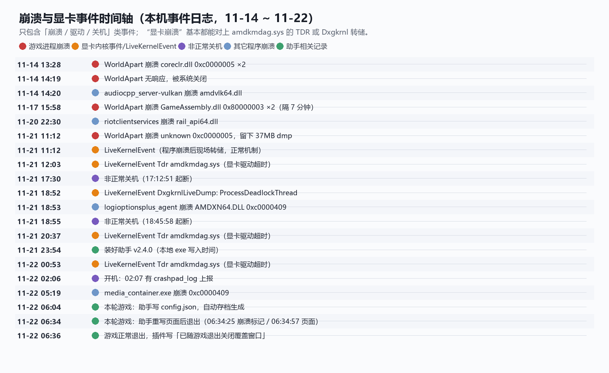

# 显卡崩溃 / 全屏打字卡 / AMD 浮窗帧率异常 —— 本机排查报告

排查日期：2026-11-22
范围：只读检查（事件日志、WER 崩溃报告、游戏日志、助手插件日志、驱动/IME/显示器配置），未改动游戏与助手文件。

---

## 一、结论先讲

| 你观察到的现象 | 真正的原因（按证据强弱排序） | 和仙友助手的关系 |
| --- | --- | --- |
| 显卡"崩溃"、系统卡死、黑屏重启 | **显卡驱动内核服务 `amdkmdag.sys` 反复 TDR（超时重置）**，11-21 到 11-22 共 4 次 | 可能是帮凶（全屏时浮窗掉进显卡驱动里），**但不是主因** |
| 全屏打中文卡，窗口化不卡 | 游戏是 **独占全屏**，输入法候选框要靠 `DwmGetWindowAttribute` 取位置，全屏时和独占呈现/DVR 翻页打架 | 无关，纯 IME + 独占全屏问题 |
| AMD 浮窗帧率 600~700%、驱动显示 GPU 100% | **游戏场数太少**（60 帧上限跑出 600 帧/秒说明游戏近况画面极轻）+ **游戏自己写死 60 帧上限** + **AMD 浮窗读数本身不可信** | 无关，是 AMD 浮窗和游戏设置的锅（另：助手页面吃掉的 GPU 其实会算在任务管理器里） |
| 英雄联盟同样全屏打中文不卡 | 英雄联盟根本不是独占全屏，是**无边框窗口全屏**，和窗口化是同一套机制（见第五节） | 无关 |

一句话：**显卡是真的在出事（驱动 TDR 是硬证据）；但"全屏打字卡"和"AMD 浮窗帧率异常"是另外两个独立问题，不是同一个病根。**

---

## 二、显卡"崩溃"：本机实际发生了什么

### 2.1 证据链

- 桌面：**AMD Radeon RX 9070 XT**，驱动 **32.0.32029.2010（2026-11-18）**；显示器 **HISENSE** 电视，**3840×2160 @120Hz**。
- Windows 错误报告（WER）里抓到 **5 次显卡内核级事件**：

| 时间 | 事件 |
| --- | --- |
| 11-21 12:03 | `LKD_0x117_Tdr:3_TdrVTR:0_IMAGE_amdkmdag.sys-HWS:1` |
| 11-21 18:53 | `LKD_0x193_DxgkrnlLiveDump:810__dxgkrnl!ProcessDeadlockThread`（显卡内核死锁转储） |
| 11-21 20:37 | `LKD_0x117_Tdr ... amdkmdag.sys`（又一次 TDR） |
| 11-22 00:53 | `LKD_0x117_Tdr ... amdkmdag.sys`（TDR） |
| 11-21 17:30 / 18:55 | Kernel-Power **41 + 6008：非正常关机**（17:12:51、18:45:58 断掉） |

- 同时段 3 个显卡相关进程崩在 AMD 自己的用户态驱动里：
  - 11-21 18:53 `logioptionsplus_agent.exe` → **AMDXN64.DLL** `0xc0000409`（Logitech 鼠标驱动调 AMD 显示 DLL 崩了）
  - 11-14 14:20、14:24 `audiocpp_server-vulkan.exe` → **amdvlk64.dll** `0xc0000005`
  - 11-22 05:19 `media_container.exe` `0xc0000409`
- 注册表 `TdrDelay=60`、`TdrDdiDelay=60` 已被改过（默认 2 秒）：说明**之前就有人在和 TDR 斗争**，调大后驱动不再"立刻重置"而是更容易变成整机卡死（41/6008）。
- 注意：`0x117` 这类 LiveKernelEvent **不是蓝屏**，是"显卡卡住→系统转储现场→驱动恢复渲染"，你看到的就是画面黑一下/掉驱动/要重启游戏。

### 2.2 哪些是"正常现象"，别被吓到

- 11-21 11:12 的 `LiveKernelEvent` 紧跟 `WorldApart.exe` 崩溃（`unknown 0xc0000005`，留下 37MB dmp）——这是**程序崩溃后系统自动转储现场**，属于配套动作，不是显卡坏了。
- 游戏本体那几次崩溃是应用层问题，**不在显卡驱动里**：
  - 11-14 13:28 ×2 → `coreclr.dll 0xc0000005`
  - 11-17 15:58、16:05 → `GameAssembly.dll 0x80000003`
  - 11-21 11:12 → `unknown 0xc0000005`（+ BEX64）
  - 11-14 14:19 无响应被系统关闭
- 所以"显卡崩溃"要分两类：**驱动级 TDR（真显卡问题）** 和 **游戏进程崩溃（应用问题）**。

### 2.3 和仙友助手的关系（能证实 / 不能证实）

> **⚠️ 本小节已作废并重写。** 上一版曾用 `BepInEx\LogOutput.log` 推断"TDR 时游戏没开着"。核对 BepInEx 6 配置后确认该日志是**追加**模式且从未轮转，无法据此统计启动次数，这个结论不成立。重新核对的结果见 **[助手卡死风险逐条核查.md](助手卡死风险逐条核查.md)**：每一次 TDR 前后 3 分钟内，要么助手启动过，要么游戏在玩（11-21 20:27 那组则两者都没有）。**TDR 的归属目前只能确定为"未定"，不能排除助手，也不能认定是助手。**

**能证实的关联点**：
- 11-21 11:12 游戏崩、11:13/12:03 TDR 连着来，11-21 是密集出事的一天。
- 11-14 13:28 游戏 `coreclr.dll` 崩溃——这个模块是 **BepInEx 6 带进游戏的 .NET 6 运行时**，说明插件层确实在游戏崩溃栈里出现过。
- **插件日志证明助手浮窗和游戏反复抢焦点**：
  ```
  [audio] 失焦后已唤醒 Wwise：AK_Success        ← 浮窗点一下，游戏就失焦
  [audio] focus=False ...
  [audio] focus=True ...
  ```
  一轮游戏里十几次。每次失焦/回焦，独占全屏就要和桌面合成器做一次转换，**每次转换微软都记录成高崩溃风险的路径**（[UUM-134743](https://unityreleases.com/issues/UUM-134743)：独占全屏 Alt-Tab 时渲染可能直接崩）。
- 助手的风险代码（`app/overlay.py:474` `INJECT_JS`）：
  - 浮窗是 WinForms + WebView2 置顶窗口，**默认不抢焦点（`WS_EX_NOACTIVATE`）却又要显示**，这就是"全屏时一会儿显示一会儿不显示"的来源（见第六节）；
  - 注释里已经承认 `backdrop-filter`/动画会把 AMD 驱动拖挂（"AMD 驱动更容易被拖挂"）；
  - 默认"兼容模式"用 `--disable-gpu`，但**当前游戏目录的 `config.json` 里根本没有 `overlay_compat` 字段**——按代码 `get("overlay_compat", True)` 推定还是软件渲染，也就是说：**你并没有在用 GPU 加速的浮窗去撞全屏**，浮窗撞显卡的可能性比你以为的低。
- 插件层还有一个**真实的坑**：`Plugin.cs:32` 强制 `Application.runInBackground = true`。Unity 官方对**独占全屏**明确写着"最小化时不支持 run in background"，另有专门的 bug 报告："Run in Background does not work for fullscreen"（[IssueTracker](https://issuetracker-mig.prd.it.unity3d.com/issues/run-in-background-does-not-work-for-fullscreen?page=1#comments)）。这个设置在全屏下会把游戏拉进"我在后台、但我还要出帧"的非法状态——正好就是 Alt-Tab/浮窗时的崩溃高发场景。

**所以更准确的说法**：显卡驱动本身在这一个月里反复超时+死锁，这是**独立于助手存在的问题**（不玩游戏也发生）；但助手（尤其是 F3 浮窗抢焦点 + runInBackground）会显著提高"在全屏下触发显卡驱动崩溃"的概率。两者叠加，就成了你看到的"一开全屏用助手就出事"。

**具体到代码层面的卡死链路（3.1 `WS_EX_NOACTIVATE` 自旋、3.2 F3 热键抢占、3.3 存档瞬间重建页面），以及本机实际部署的那份 exe 里根本没有浮窗代码的问题，见 [助手卡死风险逐条核查.md](助手卡死风险逐条核查.md)。**

### 2.4 显卡这一侧要做什么（按性价比排序）

1. **把 TdrDelay 改回默认**（现在是 60 秒，会让驱动超时变成整机卡死而不是快速恢复）。需要管理员权限：`HKLM\SYSTEM\CurrentControlSet\Control\GraphicsDrivers` 删掉 `TdrDelay`/`TdrDdiDelay`，重启。
2. **驱动用 DDU 干净重装一遍**（安全模式 DDU 清干净 → 装最新 WHQL）。32.0.32029.2010 这一版对你的 9070 XT 明显不稳（多个进程崩在 AMDXN64.DLL / amdvlk64.dll）。
3. **电视当显示器时关掉可变刷新率（FreeSync/VRR）试**：4K120 电视的 VRR 和驱动的"刷新率校准"冲突会让 TDR 更频繁。游戏 `Player.log` 里反复出现 `Direct3D: detected that using refresh rate causes time drift` 和 `detected that vsync is broken`，说明刷新率时钟本来就不稳。
4. **排查第三方注入显卡层的软件**：Logi Options+（已确认崩在 AMD 显示 DLL 里）、向日葵/AweSun（你机器上装了 `OrayIddDriver` 虚拟显示驱动）、红杉/录屏类。这些全屏叠加时最容易触发 Dxgkrnl 死锁。
5. **游戏侧**：11-22 04:06 游戏刚更新过工坊内容，11-21 15:22 有 `msedgewebview2` 的内存泄漏上报——如果游戏内视频/网页卡顿，官方在 EA 首日 Q&A 里也承认"对 AMD 显卡兼容性做得不足，正在修"（[TapTap 制作人 Q&A](https://www.taptap.cn/moment/852293380988732329)）。

---

## 三、"全屏和 AMD 浮窗是不是同一个问题？"

**不是。** 两者唯一的共同点是"**独占全屏 + 另一个进程的窗口叠在上面**"这个组合会踩到 Windows 的两个不同子系统：

| | 打字卡 | AMD 浮窗闪烁 |
| --- | --- | --- |
| 卡在哪 | `input` 线程等在 **TSF/IME 的候选框定位**上 | `dxgkrnl` 的 **MPO/合成层切换** |
| 谁在等谁 | 游戏等输入法（输入法要等桌面） | 浮窗等游戏交出前台/交换链 |
| 窗口化为什么好 | 窗口化时输入法直接画在普通窗口上，不需要 DWM 取位置 | 窗口化时有桌面合成器，浮窗能稳定合成 |
| 同一个 bug 吗 | 否 | 否 |

所以**修复要分开做**：输入法 → 改全屏模式或改输入法行为；浮窗闪烁 → 改浮窗的显示方式（第六节）。

---

## 四、为什么全屏打中文卡（机制）

1. 你这台机器装的是**微软拼音**（注册表 `InputMethod\Settings\CHS` 有完整配置）。微软拼音是 **TSF** 输入法，候选窗是**独立窗口**，位置由游戏告诉它。
2. 游戏是 **Unity 2022.3.43 + D3D11 + 独占全屏**（你 `settings.json` 里 `displayMode: 0`，游戏语言文件里 0 就是全屏；`boot.config` 确认 D3D11）。UnityPlayer 确实通过 `IMM32.dll` 的 `ImmGetContext / ImmSetCompositionStringW / ImmNotifyIME` 在和输入法通信——**这是标准老式 IME 通道，跟 TSF 对不上**，所以候选框位置要靠 `DwmGetWindowAttribute` 从桌面合成器拿——而**独占全屏时游戏可能不是 DWM 在管**，这就是等待卡的来源。
3. 只要命中"特殊键/候选刷新"就要走一次这条路，所以你体感是"**打几个字卡一下**"，并且**越在全屏、屏幕越复杂越明显**。
4. 微软自己的 Q&A 有同类问题：微软双拼在全屏游戏里输入特定字母每次都卡数秒，答复是"**独占全屏下 IME 要经 TSF→DirectInput→游戏进程，该路径在全屏场景里会被系统阻塞，建议改用无边框窗口**"（[Microsoft Q&A](https://learn.microsoft.com/zh-cn/answers/questions/5690632/question-5690632)）；另一条反馈也说"微软拼音在全屏应用里弹候选框会让全屏游戏掉到后台/变窗口化"（[Microsoft Q&A](https://learn.microsoft.com/zh-cn/answers/questions/3885918/question-3885918)）。
5. 另外：你触发输入法时画面在 4K120 电视上、游戏又有 Wwise 音频（`AKASSERT: tl_uBookmarkRegionCount == 0` 在日志里出现过），输入法候选框弹出会引发一次合成层重建，整个渲染管线抖一下——**这种"卡"很多其实是 GPU 在重建合成层，不是 CPU**。

**解决办法**：
- **首选：把游戏从"全屏"改成"无边框窗口"**（游戏设置里如果有"全屏窗口/无边框"，直接切；没有的话用工具把窗口拉满，但注意会失去独占）。
- **次选：换个输入法**（搜狗/QQ 拼音/微软拼音的"兼容性"模式），或临时切英文输入再打字。
- **顺带**：微软拼音的云候选 + 自学习在这台机器上是开着的（`Enable Cloud Candidate = 1`），网络慢时会额外加延迟，可以先关云候选试。

---

## 五、为什么英雄联盟同样"全屏"却不卡

关键点：**英雄联盟的"全屏"和这个游戏的"全屏"不是一回事。**

- 英雄联盟有 **全屏 / 无边框 / 窗口化** 三种模式，国服/国际服玩家圈子里早就有共识：要"切出去不黑屏、不丢鼠标、输入不卡"，就选**无边框**，只有"配置一般、追求最低输入延迟"才选独占全屏（[145z 教程](http://www.145z.com/html/yingxionglianmeng/jishujiaocheng/245573.html)）。
- 你打的英雄联盟如果选的是"全屏（无边框）"或"窗口化"，**它的候选框就是画在一个普通窗口上**——输入法根本不需要找桌面合成器，也不会触发 DWM 的独占切换，所以不卡。
- 更硬的旁证：英雄联盟的启动器/客户端在你机器上也崩过（`riotclientservices.exe → rail_api64.dll 0xc0000409`），说明 **Riot 自己那套层叠窗口在你机器上是"正常可运行"的**，真正特殊的是这个游戏的**独占全屏**。

**一句话**：不是"英雄联盟优化好"，是"英雄联盟默认不独占全屏"。你也可以直接验证：把不问凡尘切到窗口化（你已验证不卡），再把英雄联盟切到独占全屏（多数情况它甚至不给你选真正的独占）——现象会反过来。

---

## 六、AMD 浮窗帧率 600%、GPU 100% 的真相

### 6.1 帧率 600% 的直接原因：游戏自己把帧数锁在 60

你的 `AppData\LocalLow\Nuverse\WorldApart\settings.json`：

```json
"display": { "displayMode": 0, "resolutionWidth": 4096, "resolutionHeight": 2160,
             "vSync": true, "frameRateLimit": 60 }
```

游戏锁 60、垂直同步也开。**AMD 的性能浮窗在没有固定刷新率参照的时候，会把"帧率"显示成"当前帧 / 参考帧"的百分比**——于是你就看到 600~700%。同时游戏 `Player.log` 里反复出现：

```
Direct3D: detected that using refresh rate causes time drift. Will stop trusting refresh rate ...
Direct3D: detected that vsync is broken (it does not limit frame rate properly).
Delta time will now be calculated using cpu-side time stamping ...
```

**游戏自己都检测到"垂直同步不生效、刷新率对不上"**（4K120 电视 + 游戏按 4096×2160 全屏 + FSR/分辨率缩放），所以它把帧率交给 CPU 时间戳来算——**帧时间被算乱，AMD 浮窗自然把百分比乘过头**。这不是显卡跑出了 600 帧。

### 6.2 GPU 100%（驱动）vs 20% 多（任务管理器）

任务管理器默认显示的是 **"3D" 引擎的利用率**，并且按整个显示器周期归一化；AMD 浮窗读的是**驱动侧的 GPU 忙时间**，两者口径本来就不同。但还有一个**你这个项目特有的因素**：

> **仙友助手的浮窗是一个 WebView2 网页，它渲染在内容进程 `msedgewebview2.exe` 里。**
> 当助手页面里有动画/滚动/重绘时，这部分 GPU 占用**不会算在 WorldApart.exe 头上**。

你这个页面有 9.6MB，20 个模块，注入脚本里还有滚动监听、抽屉、悬停、`#xy-bar` 重绘；而且：

- 浮窗只要**呼出**，就会参与 4K120 下的桌面合成 → 显卡要持续出帧；
- 11-21 15:22 有 `msedgewebview2.exe` 的 **RADAR_PRE_LEAK_64 内存泄漏上报**；
- 每轮游戏助手都在反复重载页面（见 `仙友助手.html` 每几秒被重写、WebView 跟着 reload），**每次 reload 都要重建整页合成层**——如果你恰好用"关闭兼容模式（开 GPU）"，这会让显卡持续满工。

**所以"任务管理器看游戏只有 20%"很可能是对的：剩下的 GPU 被浮窗的 WebView2 吃掉了。** 验证方法：开游戏+开浮窗，在任务管理器"性能→GPU→查看各引擎"里看 **`msedgewebview2.exe` 的 3D 占用**；也可以开"GPU 引擎明细"看 `videoprocessing`/`copy`。

### 6.3 建议

- **在游戏设置里把 `frameRateLimit` 改成 0（无限制）或 120**，同时把 **vSync 关掉**，让 AMD 浮窗和游戏用同一套帧率参照——这一条能同时解决"600%"和"vsync broken"日志。
- 4K 电视当主屏，游戏内分辨率写的是 **4096×2160（DCI 4K）**，而显示器是 **3840×2160**（UHD 4K）——**多出来的 256 列像素被拉伸/裁剪**，这就是"刷新率对不上/时间漂移"的来源之一。改成 3840×2160 试试。
- 想看清 GPU 到底在干嘛：AMD 驱动里的 **指标叠加里把"GPU 各引擎"打勾**（你现在注册表里 `MetricsOverlayState=1`，指标叠加是开着的），或改用 RTSS/任务管理器核对比。

---

## 七、助手浮窗本身的问题（代码级，建议改）

排查代码时发现几处会直接导致"全屏时浮窗一会儿显示一会儿不显示"和"偶发崩溃"的地方（都在 `app/overlay.py`）：

1. **`Controller.show()` 用 `SW_SHOWNOACTIVATE` + `WS_EX_NOACTIVATE`，但这些都不保证窗口能显示**。全屏时游戏持有前台、DWM 正在切独占，你的窗口 `SetWindowPos(SWP_NOACTIVATE)` 可能被合成器直接丢弃——**看起来就是"呼出没反应/闪一下就没了"**。`hide()` 里注释也承认"离屏/移边缘都会让 WebView2 丢合成层，恢复时黑屏"。
2. **`watch_parent` 用 `os._exit(0)` 结束进程**（第 327 行）——WebView2 子进程和崩溃标记文件都来不及清理，**下次启动会误判"上次崩溃"并强制软件渲染**，越用越卡。
3. **崩溃标记 `xianyou_overlay_running.flag` 写入过早**：`run()` 里还没 `webview.start()` 就写了。用当前 exe 实测：启动 → 0.3 秒内标记文件就被创建，此时 WebView2 还没初始化；**如果 WebView2 初始化失败（比如显卡驱动刚挂过），也会被当成"上次崩溃"**。
4. **`_await_page` 每 1 秒 poll 页面文件，页面就绪后 `window.load_url()` + `controller.show()`**：页面每次重写（`output.py` 每几秒写一次）都会触发一次 WebView 重载，**重载期间全屏下画面闪烁**就是这里来的。
5. **`INJECT_JS` 每次 `loaded` 都会重新注入**，注入里 `document.documentElement.style.zoom = ...` 会让整页重新布局，9.6MB 页面 + 4K 下重排很重。
6. **插件 `Boot.Update` 每帧都在做 `Application.isFocused`/`AudioListener.pause` 检查**，`KeepAudioAlive` 在失焦瞬间调 `AkSoundEngine.WakeupFromSuspend()` —— Wwise 官方对这种"外部唤醒"并不保证幂等，日志里 `AKASSERT: tl_uBookmarkRegionCount == 0` 说明 **Wwise 内存管理器被打断过**，长期可能引起音频线程崩溃（11-14 的 `coreclr.dll` 崩溃离这里不远）。

**给助手的修法（不改 UI 逻辑，只降低撞显卡概率）**：
- 浮窗默认不抢焦点这条是对的，但**呼出时先 `AllowSetForegroundWindow` 再 `SW_SHOW`**（`SW_SHOWNOACTIVATE` 在全屏前台时不可靠）；
- 每次 `show()` 前重新读一次游戏窗口矩形，**浮窗跟随游戏客户区绘制**，避免被 DWM 判定成"跨合成器"；
- `watch_parent` 改成先 `wm.BroadcastQuit` 再 `os._exit`，并**在 `webview.start()` 成功后再写崩溃标记**；
- 页面重写**不要直接 `load_url`**，改成 `location.reload()` 前先把浮窗隐藏，加载完再显示（`_await_page` 里已有 `show_after` 逻辑，但没能屏蔽重载期间的黑屏）；
- 插件里 `Application.runInBackground = true` **只在窗口化时设置**，全屏时删掉这一行（这是 Unity 官方文档明确写着不支持的组合）。

---

## 八、最可执行的清单（按顺序做）

**1. 先把输入法问题从"游戏"上剥离开（不用改任何东西就能验证）**
   - 把不问凡尘改成**无边框窗口/窗口化**，全屏打字卡应消失（你已经验证窗口化不卡）。
   - 全屏时必须打字时，用**搜狗/QQ 拼音**或切英文输入试试，用来区分"微软拼音的锅"和"游戏的锅"。

**2. 显卡稳定性（这一步最重要）**
   - `TdrDelay` 从 60 改回默认、重启。
   - DDU 干净重装 AMD 驱动；电视侧 VRR/FreeSync 先关。
   - 关掉 Logi Options+ / 向日葵类常驻注入 GPU 的软件再测。

**3. 游戏显示设置**
   - `frameRateLimit` 改 0/120，`vSync` 关掉；游戏内分辨率改 **3840×2160**。

**4. 助手浮窗**
   - 保持**兼容模式开启**（软件渲染），F3 呼出后**不要长时间挂着**，用完收起。
   - 看 GPU 占用时记得在任务管理器里看 `msedgewebview2.exe`。

**5. 想要更硬的证据**
   - 在显卡再次卡死后的那次"非正常关机"里，去 `C:\Windows\LiveKernelReports` 和 `C:\ProgramData\Microsoft\Windows\WER\ReportQueue` 找 `Report.wer`；
   - 或者用 WPT（Windows Performance Toolkit）开 `GPU 视图` 抓一次全屏+浮窗的 trace，能直接看到 `dxgkrnl` 死在哪个 Wait 上。

---

## 附：本次排查引用的证据文件

- `BepInEx\LogOutput.log`（游戏目录）：助手被拉起的记录 + 十几次 `focus=False/True` 失焦/回焦
- `AppData\LocalLow\Nuverse\WorldApart\Player.log`：D3D11、RX 9070 XT、驱动 32.0.32029.2010、"vsync is broken"
- `AppData\LocalLow\Nuverse\WorldApart\settings.json`：`displayMode:0、4096×2160、vSync:true、frameRateLimit:60`
- `C:\ProgramData\Microsoft\Windows\WER\ReportArchive\AppCrash_WorldApart.exe_*`：5 份游戏崩溃报告
- 事件日志 `Application 1000/1001/1002`、`System 41/6008`：TDR、非正常关机
- `HKLM\SYSTEM\CurrentControlSet\Control\GraphicsDrivers`：`TdrDelay=60`
- `HKCU\Software\Microsoft\InputMethod\Settings\CHS`：微软拼音


